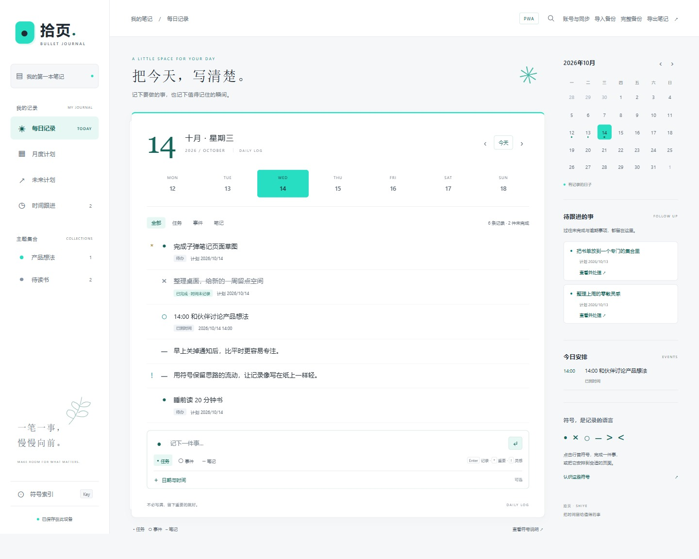
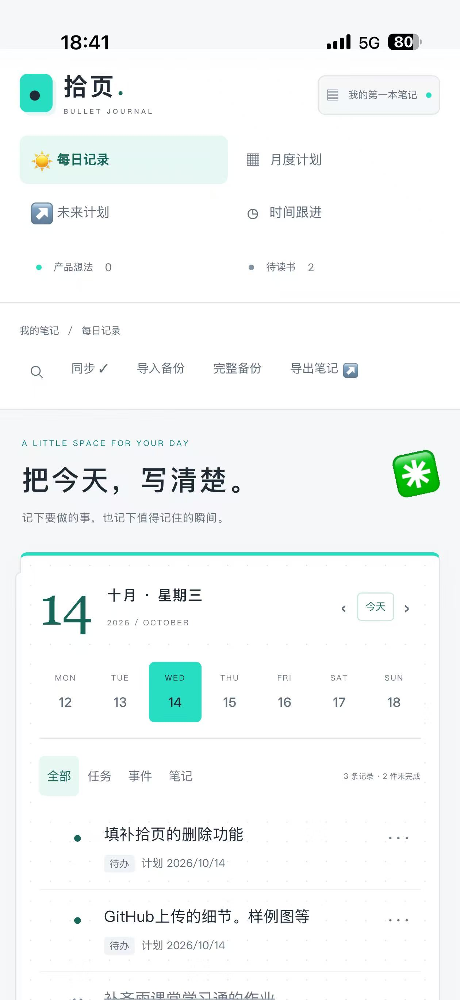
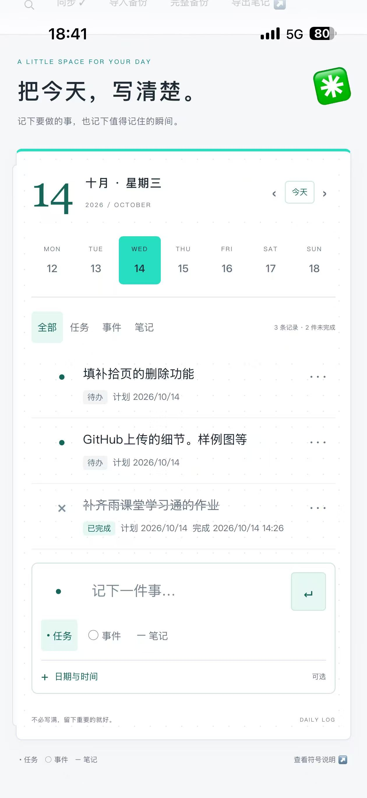

# 拾页 · 子弹笔记

可离线使用的子弹笔记 PWA，支持 PC / iPhone 云同步和 Scriptable 小组件。采用白色、冷灰和薄荷绿配色。

保留 • 任务、× 完成、○ 事件、– 笔记、> 迁移、< 未来安排、* 重要、! 灵感，并记录开始、截止、完成和改期历史。

[在线体验（测试版）](https://bullet-journal-d2guqi0w01155b1c1-1441422350.tcloudbaseapp.com/) · [独立部署](docs/cloudbase-setup.md) · [iPhone 与小组件](docs/iphone-setup.md)

在线体验使用项目维护者的 CloudBase 环境，笔记按账号隔离。腾讯云默认测试域名会显示访问提示；正式使用应配置自定义域名。下载源码后默认运行本地模式，不会连接维护者的云端。

## 界面预览

### 网页端

本地运行的每日记录页面，使用项目内置示例数据，展示记录列表、日期导航、待跟进事项和今日安排。



### iPhone 实机

以下为 iPhone 上的实际运行截图，展示页面导航、待办与已完成记录，以及新增记录入口。

<table>
  <tr>
    <td width="50%" align="center"><strong>导航与每日记录</strong></td>
    <td width="50%" align="center"><strong>任务状态与记录输入</strong></td>
  </tr>
  <tr>
    <td align="center"></td>
    <td align="center"></td>
  </tr>
</table>

截图用于展示界面；完整的同步、离线恢复和小组件验收范围见 [验收记录](docs/verification.md)。

## 本地运行

需要 Node.js 20.19 或更高版本。

```sh
npm ci
npm start
```

打开 http://127.0.0.1:4173/ 。启动前会自动生成官方 Web SDK 与图标资源。本地测试账号仅用于本机服务；跨设备使用需完成 CloudBase 部署。

```sh
npm run check
npm test
npm run build
```

本地构建生成 dist/web 与两个云函数代码包，不会自动发布、创建凭据或修改数据库。构建产物和运行数据不提交到 GitHub。

## 部署自己的云端

本项目使用腾讯云 CloudBase 的 PostgreSQL、身份认证、云函数、HTTP 网关及静态托管。GitHub 保存源码；云同步后端仍运行在 CloudBase。

将 .env.example 复制为 .env，填写自己的环境 ID、网页地址、只读 API 地址及官方 CLI 路径。不要把后端 API Key 写入前端配置。

```sh
node --env-file=.env scripts/build.mjs --email-login
```

完整的初始化、邮箱配置和部署顺序见 [CloudBase 部署说明](docs/cloudbase-setup.md)。每个云环境使用独立项目目录，部署脚本会拒绝混用另一个环境的缓存配置。

## 功能

- 每日记录、月度计划、未来计划、主题集合和搜索。
- 任务开始、完成、取消、恢复与迁移；事件发生、取消、改期和备注。
- IndexedDB 离线缓存、持久待同步队列、操作去重和版本冲突处理。
- 同一任务迁移链整体同步，保持一个有效落点；冲突草稿保留在本机。
- 账号隔离，服务端验证可信用户身份。
- 独立且可撤销的只读小组件凭据；服务端仅保存凭据哈希。
- JSON / Markdown 导出，以及将 JSON 中的笔记合并导入。

支持将所选记录移到可恢复的回收站，并预览清理误合并的旧笔记；没有永久删除。操作方法见 [旧笔记清理说明](docs/cleanup-old-notes.md)。云同步使用前台每 30 秒轮询及联网/焦点触发，尚未接入 PostgreSQL Realtime。事件没有系统推送提醒，Scriptable 刷新由 iOS 调度。

旧版浏览器笔记会迁入 IndexedDB，并保留原始备份。退出账号不会删除该账号的本地队列。JSON 备份包含记录、队列、冲突和草稿；导入只合并笔记，不恢复旧队列或冲突。

## 代码结构

| 文件 | 作用 |
| --- | --- |
| journal-core.js | 符号、状态、迁移和时间规则 |
| sync-model.js / sync-engine.js | 分组、IndexedDB、队列与冲突 |
| src/cloudbase-adapter.js | 官方 Web SDK 登录和云函数接入 |
| backend/service.cjs | 同步操作与小组件授权 |
| backend/pg-store.cjs / cloudbase/migrations | PostgreSQL 存储、事务及权限 |
| backend/widget-http.cjs | 只读 HTTPS 摘要 |
| scriptable/拾页.js | iPhone 小组件 |
| server.mjs | 绑定本机回环地址的开发服务 |
| scripts/deploy-cloudbase.mjs | 显式执行的云部署步骤 |

测试与已验证范围见 [验收记录](docs/verification.md)。邮件实际收信和实体 iPhone 使用仍需部署者实测。

## 许可证

本项目采用 [MIT License](LICENSE)。第三方依赖遵循各自许可证。
